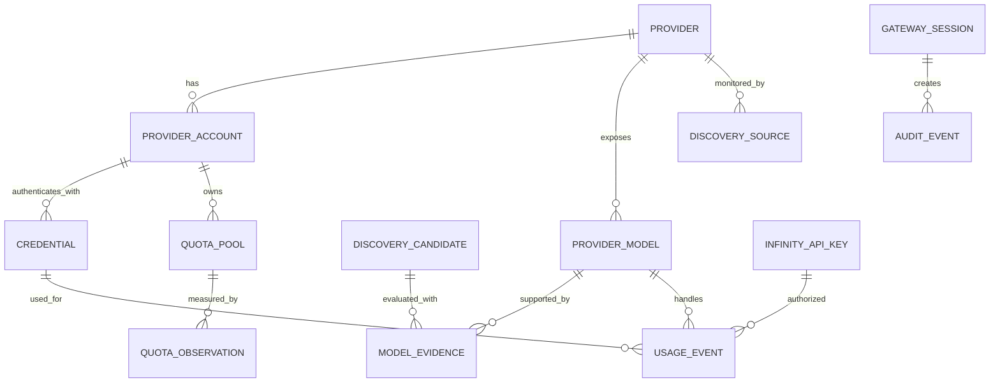

# Infinity Multiple LLM API — Database Schema & Migration Plan v0.4

**Status:** Planning specification; not yet applied to the source repository  
**Date:** 3 November 2026  
**Database baseline:** SQLite per gateway installation, with forward-compatible SQL and repository-layer isolation  
**Scope:** Provider/API-key management, free-model registry and discovery, quota monitoring, usage ledger, unified gateway, Android control-panel pairing.

## 1. Data ownership and deployment boundaries

Each gateway installation owns its own operational database and credential vault:

- A local gateway has its own database and encrypted provider credentials.
- A remote gateway has a separate database and encrypted provider credentials.
- The Android app stores gateway connection profiles and pairing/session material, not a second copy of provider secrets.
- Switching gateways changes the active control target. It does not merge databases or copy secrets.
- Backups are gateway-specific. A restore must restore the database and its separately managed encryption key material together.

The initial product is single-owner / single-operator per gateway. Tables include ownership and scope fields where useful, but this schema does **not** imply a multi-tenant hosted SaaS product.

## 2. Core entity relationship overview



The relationship is conceptual: a quota pool can be account-wide, key-wide, model-specific, or endpoint-specific. Do not assume every observation belongs to one credential.

## 3. Table catalogue

### 3.1 Registry and catalog

| Table | Purpose | Important fields |
|---|---|---|
| `providers` | Canonical provider registry | `id`, `slug`, `name`, official URLs, lifecycle state, region/payment metadata, timestamps |
| `provider_endpoints` | Provider API endpoints and protocol variants | `provider_id`, endpoint type, base URL, protocol, region, enabled |
| `provider_capabilities` | Normalized capability declarations | `provider_id`, capability, support state, evidence/source |
| `provider_models` | Provider-specific model identity | `provider_id`, upstream model ID, display name, lifecycle, capability metadata |
| `model_capabilities` | Per-model capability assertions | model ID, capability, support state, evidence reference |
| `model_pricing` | Price records with effective dates and units | model ID, input/output price, currency, unit, effective interval, source |
| `model_evidence` | Evidence supporting access/pricing/capability claims | model ID or candidate ID, evidence type, URL, excerpt/hash, checked time, confidence |

`provider_models` uses the unique identity `(provider_id, upstream_model_id, endpoint_scope)`. Infinity's public model identifier is derived from a stable internal model ID, not from a mutable display name.

### 3.2 Provider accounts and secrets

| Table | Purpose | Important fields |
|---|---|---|
| `provider_accounts` | A user's account at a provider | provider, label, region, account class, status, quota-sharing hint |
| `credentials` | API keys and OAuth credentials | account, type, encrypted payload, key version, scopes, expiry, status, validation time |
| `credential_events` | Rotation, validation, revocation history | credential ID, event, safe metadata, timestamp |

A provider account may have multiple credentials. Credentials are not the quota pool: several keys can share one account quota.

Secret fields are ciphertext only. Store encryption metadata (`key_version`, algorithm, nonce/tag as required by the chosen AEAD scheme) alongside ciphertext. The master encryption key must live outside SQLite in the gateway's secret store/environment or OS-backed keystore. Never store plaintext secrets, provider passwords, or master keys in these tables.

### 3.3 Quota and usage

| Table | Purpose | Important fields |
|---|---|---|
| `quota_pools` | Identity of a provider quota bucket | provider/account, scope, metric, unit, external pool identity |
| `quota_pool_credentials` | Many-to-many mapping of credentials to shared pools | pool ID, credential ID |
| `quota_observations` | Time-series snapshots from provider/header/manual sources | pool, limit, used, remaining, reset, source, confidence, observed time |
| `usage_events` | Gateway-observed request ledger | request ID, provider/model/credential/API key, tokens, count, latency, status, provenance |
| `usage_daily_rollups` | Aggregated usage for dashboard performance | date, provider/model, request counts, token totals, error counts |

Quota metrics must preserve their native units: requests, tokens, credits, characters, images, seconds, or provider-defined units. Never add unlike units. `reset_at` remains nullable when the provider does not disclose a reset time.

`usage_events` records calls that pass through Infinity only. It cannot claim to include usage made directly on provider dashboards or other applications.

Token provenance values: `provider_reported`, `gateway_estimated`, `unavailable`. Quota source values: `official_api`, `response_header`, `error_response`, `documentation`, `manual`, `gateway_counter`.

### 3.4 Discovery and review

| Table | Purpose | Important fields |
|---|---|---|
| `discovery_sources` | Official catalog/API/docs/release sources | provider, source type, URL, polling policy, enabled |
| `discovery_runs` | Each scheduled/manual discovery execution | source, start/end, status, safe summary |
| `discovery_candidates` | Newly seen or changed provider/model candidates | provider, upstream ID, proposed metadata, review state |
| `discovery_candidate_evidence` | Evidence collected for candidate | candidate, evidence ID, relationship/relevance |
| `verification_decisions` | Versioned classification decision | candidate/model, free-tier status, confidence, decision reason, verifier version, decided time |

Free-tier classification is separate from provider lifecycle and model availability. Allowed states: `verified_recurring_free`, `verified_restricted_free`, `trial_or_promo`, `paid`, `unknown`, `retired_or_discontinued`.

Automatic registration rule: only verified recurring-free and verified restricted-free candidates are eligible for automatic catalog registration. Trial/promo, unknown, conflicting or potentially paid candidates remain in Review. Every decision records its evidence and verifier version so past decisions can be audited.

### 3.5 Gateway, Android pairing, API keys and audit

| Table | Purpose | Important fields |
|---|---|---|
| `gateway_settings` | Non-secret gateway configuration | setting key/value, updated time; secrets excluded |
| `infinity_api_keys` | Keys issued by Infinity to external clients | key ID, hashed secret, display prefix, scopes, status, expiry, last used |
| `gateway_pairings` | Android control-panel pairing metadata | device label, public/device identifier, status, paired/revoked times |
| `gateway_sessions` | Revocable dashboard sessions | token hash, pairing/user context, expiry, last seen |
| `audit_events` | Security-sensitive action history | actor, action, object type/id, safe metadata, timestamp |
| `notifications` | In-app alerts | type, severity, title/body, target reference, read/dismissed time |
| `schema_migrations` | Applied migration ledger | migration ID, checksum, applied time |

Infinity API keys are distinct from provider credentials. Store only a one-way hash of the presented Infinity key; show the full value once at creation. Provider credentials require reversible authenticated encryption because the gateway must use them upstream.

## 4. SQLite baseline migration (illustrative core DDL)

This is the initial relational baseline. Production migrations should split these statements into small numbered files, add strict validation in application code, and include rollback/backup tests. JSON columns hold provider-specific metadata only; query-critical fields remain relational columns.

```sql
PRAGMA foreign_keys = ON;

CREATE TABLE providers (
  id TEXT PRIMARY KEY,
  slug TEXT NOT NULL UNIQUE,
  name TEXT NOT NULL,
  official_url TEXT,
  signup_url TEXT,
  docs_url TEXT,
  lifecycle_state TEXT NOT NULL CHECK (lifecycle_state IN ('candidate','verified','active','degraded','paused','retired')),
  free_tier_state TEXT NOT NULL DEFAULT 'unknown' CHECK (free_tier_state IN ('verified_recurring_free','verified_restricted_free','trial_or_promo','paid','unknown','retired_or_discontinued')),
  region_metadata_json TEXT NOT NULL DEFAULT '{}',
  payment_requirement TEXT NOT NULL DEFAULT 'unknown' CHECK (payment_requirement IN ('required','not_required','sometimes_required','unknown')),
  metadata_json TEXT NOT NULL DEFAULT '{}',
  created_at TEXT NOT NULL,
  updated_at TEXT NOT NULL,
  last_verified_at TEXT
);

CREATE TABLE provider_endpoints (
  id TEXT PRIMARY KEY,
  provider_id TEXT NOT NULL REFERENCES providers(id) ON DELETE CASCADE,
  endpoint_type TEXT NOT NULL,
  base_url TEXT NOT NULL,
  protocol TEXT NOT NULL,
  region TEXT,
  enabled INTEGER NOT NULL DEFAULT 1 CHECK (enabled IN (0,1)),
  metadata_json TEXT NOT NULL DEFAULT '{}',
  UNIQUE(provider_id, endpoint_type, base_url)
);

CREATE TABLE provider_accounts (
  id TEXT PRIMARY KEY,
  provider_id TEXT NOT NULL REFERENCES providers(id) ON DELETE RESTRICT,
  label TEXT NOT NULL,
  region TEXT,
  account_class TEXT NOT NULL DEFAULT 'unknown',
  status TEXT NOT NULL DEFAULT 'active' CHECK (status IN ('active','invalid','paused','revoked','unknown')),
  metadata_json TEXT NOT NULL DEFAULT '{}',
  created_at TEXT NOT NULL,
  updated_at TEXT NOT NULL
);

CREATE TABLE credentials (
  id TEXT PRIMARY KEY,
  provider_account_id TEXT NOT NULL REFERENCES provider_accounts(id) ON DELETE CASCADE,
  credential_type TEXT NOT NULL CHECK (credential_type IN ('api_key','oauth')),
  label TEXT,
  encrypted_payload BLOB NOT NULL,
  encryption_algorithm TEXT NOT NULL,
  key_version TEXT NOT NULL,
  nonce BLOB NOT NULL,
  auth_tag BLOB,
  scopes_json TEXT NOT NULL DEFAULT '[]',
  expires_at TEXT,
  status TEXT NOT NULL DEFAULT 'active' CHECK (status IN ('active','expired','invalid','revoked','paused')),
  created_at TEXT NOT NULL,
  updated_at TEXT NOT NULL,
  last_validated_at TEXT
);

CREATE TABLE provider_models (
  id TEXT PRIMARY KEY,
  provider_id TEXT NOT NULL REFERENCES providers(id) ON DELETE RESTRICT,
  upstream_model_id TEXT NOT NULL,
  endpoint_scope TEXT NOT NULL DEFAULT 'default',
  display_name TEXT NOT NULL,
  description TEXT,
  availability_state TEXT NOT NULL DEFAULT 'unverified' CHECK (availability_state IN ('available','degraded','unavailable','unverified','retired')),
  free_tier_state TEXT NOT NULL DEFAULT 'unknown' CHECK (free_tier_state IN ('verified_recurring_free','verified_restricted_free','trial_or_promo','paid','unknown','retired_or_discontinued')),
  context_window INTEGER,
  max_output_tokens INTEGER,
  metadata_json TEXT NOT NULL DEFAULT '{}',
  first_seen_at TEXT NOT NULL,
  last_seen_at TEXT NOT NULL,
  last_verified_at TEXT,
  UNIQUE(provider_id, upstream_model_id, endpoint_scope)
);

CREATE TABLE model_capabilities (
  id TEXT PRIMARY KEY,
  provider_model_id TEXT NOT NULL REFERENCES provider_models(id) ON DELETE CASCADE,
  capability TEXT NOT NULL,
  support_state TEXT NOT NULL CHECK (support_state IN ('supported','unsupported','unknown')),
  evidence_id TEXT,
  checked_at TEXT,
  UNIQUE(provider_model_id, capability)
);

CREATE TABLE model_evidence (
  id TEXT PRIMARY KEY,
  provider_model_id TEXT REFERENCES provider_models(id) ON DELETE CASCADE,
  candidate_id TEXT,
  evidence_type TEXT NOT NULL,
  source_url TEXT,
  source_title TEXT,
  excerpt TEXT,
  content_hash TEXT,
  confidence REAL CHECK (confidence IS NULL OR (confidence >= 0 AND confidence <= 1)),
  observed_at TEXT NOT NULL,
  expires_at TEXT,
  metadata_json TEXT NOT NULL DEFAULT '{}'
);

CREATE TABLE quota_pools (
  id TEXT PRIMARY KEY,
  provider_account_id TEXT NOT NULL REFERENCES provider_accounts(id) ON DELETE CASCADE,
  external_pool_id TEXT,
  scope_type TEXT NOT NULL CHECK (scope_type IN ('account','credential','model','endpoint','organization','unknown')),
  scope_ref TEXT,
  metric TEXT NOT NULL,
  unit TEXT NOT NULL,
  label TEXT,
  created_at TEXT NOT NULL,
  UNIQUE(provider_account_id, external_pool_id, scope_type, scope_ref, metric, unit)
);

CREATE TABLE quota_pool_credentials (
  quota_pool_id TEXT NOT NULL REFERENCES quota_pools(id) ON DELETE CASCADE,
  credential_id TEXT NOT NULL REFERENCES credentials(id) ON DELETE CASCADE,
  PRIMARY KEY(quota_pool_id, credential_id)
);

CREATE TABLE quota_observations (
  id TEXT PRIMARY KEY,
  quota_pool_id TEXT NOT NULL REFERENCES quota_pools(id) ON DELETE CASCADE,
  limit_value REAL,
  used_value REAL,
  remaining_value REAL,
  reset_at TEXT,
  reset_strategy TEXT NOT NULL DEFAULT 'unknown',
  source TEXT NOT NULL CHECK (source IN ('official_api','response_header','error_response','documentation','manual','gateway_counter')),
  confidence REAL CHECK (confidence IS NULL OR (confidence >= 0 AND confidence <= 1)),
  observed_at TEXT NOT NULL,
  evidence_url TEXT,
  freshness_state TEXT NOT NULL DEFAULT 'fresh' CHECK (freshness_state IN ('fresh','stale','expired','unknown')),
  notes TEXT
);

CREATE TABLE usage_events (
  id TEXT PRIMARY KEY,
  request_id TEXT NOT NULL UNIQUE,
  provider_id TEXT REFERENCES providers(id) ON DELETE SET NULL,
  provider_account_id TEXT REFERENCES provider_accounts(id) ON DELETE SET NULL,
  credential_id TEXT REFERENCES credentials(id) ON DELETE SET NULL,
  provider_model_id TEXT REFERENCES provider_models(id) ON DELETE SET NULL,
  infinity_api_key_id TEXT,
  endpoint TEXT NOT NULL,
  request_count INTEGER NOT NULL DEFAULT 1,
  input_tokens INTEGER,
  output_tokens INTEGER,
  total_tokens INTEGER,
  token_provenance TEXT NOT NULL DEFAULT 'unavailable' CHECK (token_provenance IN ('provider_reported','gateway_estimated','unavailable')),
  status TEXT NOT NULL CHECK (status IN ('success','error','cancelled','timeout')),
  upstream_status INTEGER,
  latency_ms INTEGER,
  was_retry INTEGER NOT NULL DEFAULT 0 CHECK (was_retry IN (0,1)),
  was_fallback INTEGER NOT NULL DEFAULT 0 CHECK (was_fallback IN (0,1)),
  error_category TEXT,
  created_at TEXT NOT NULL
);

CREATE TABLE discovery_candidates (
  id TEXT PRIMARY KEY,
  provider_id TEXT REFERENCES providers(id) ON DELETE SET NULL,
  candidate_type TEXT NOT NULL CHECK (candidate_type IN ('provider','model','change')),
  upstream_id TEXT,
  proposed_name TEXT,
  proposed_metadata_json TEXT NOT NULL DEFAULT '{}',
  review_state TEXT NOT NULL DEFAULT 'pending' CHECK (review_state IN ('pending','auto_accepted','approved','rejected','deferred')),
  free_tier_state TEXT NOT NULL DEFAULT 'unknown',
  discovered_at TEXT NOT NULL,
  reviewed_at TEXT,
  review_note TEXT
);

CREATE TABLE discovery_sources (
  id TEXT PRIMARY KEY,
  provider_id TEXT REFERENCES providers(id) ON DELETE CASCADE,
  source_type TEXT NOT NULL,
  source_url TEXT NOT NULL,
  polling_interval_seconds INTEGER,
  enabled INTEGER NOT NULL DEFAULT 1 CHECK (enabled IN (0,1)),
  last_checked_at TEXT,
  last_status TEXT,
  UNIQUE(provider_id, source_url)
);

CREATE TABLE discovery_runs (
  id TEXT PRIMARY KEY,
  discovery_source_id TEXT REFERENCES discovery_sources(id) ON DELETE SET NULL,
  started_at TEXT NOT NULL,
  finished_at TEXT,
  status TEXT NOT NULL CHECK (status IN ('running','succeeded','partial','failed')),
  candidates_found INTEGER NOT NULL DEFAULT 0,
  summary TEXT
);

CREATE TABLE infinity_api_keys (
  id TEXT PRIMARY KEY,
  label TEXT NOT NULL,
  secret_hash TEXT NOT NULL UNIQUE,
  display_prefix TEXT NOT NULL,
  scopes_json TEXT NOT NULL DEFAULT '["inference"]',
  status TEXT NOT NULL DEFAULT 'active' CHECK (status IN ('active','revoked','expired')),
  created_at TEXT NOT NULL,
  expires_at TEXT,
  last_used_at TEXT
);

CREATE TABLE notifications (
  id TEXT PRIMARY KEY,
  notification_type TEXT NOT NULL,
  severity TEXT NOT NULL DEFAULT 'info' CHECK (severity IN ('info','warning','critical')),
  title TEXT NOT NULL,
  body TEXT NOT NULL,
  target_type TEXT,
  target_id TEXT,
  created_at TEXT NOT NULL,
  read_at TEXT,
  dismissed_at TEXT
);

CREATE TABLE audit_events (
  id TEXT PRIMARY KEY,
  actor_type TEXT NOT NULL,
  actor_id TEXT,
  action TEXT NOT NULL,
  object_type TEXT,
  object_id TEXT,
  safe_metadata_json TEXT NOT NULL DEFAULT '{}',
  created_at TEXT NOT NULL
);

CREATE TABLE schema_migrations (
  migration_id TEXT PRIMARY KEY,
  checksum TEXT NOT NULL,
  applied_at TEXT NOT NULL
);

CREATE INDEX idx_models_provider_state ON provider_models(provider_id, availability_state, free_tier_state);
CREATE INDEX idx_quota_pool_observed ON quota_observations(quota_pool_id, observed_at DESC);
CREATE INDEX idx_usage_created ON usage_events(created_at DESC);
CREATE INDEX idx_usage_provider_model ON usage_events(provider_id, provider_model_id, created_at DESC);
CREATE INDEX idx_discovery_review ON discovery_candidates(review_state, discovered_at DESC);
CREATE INDEX idx_credentials_account_status ON credentials(provider_account_id, status);
CREATE INDEX idx_notifications_unread ON notifications(read_at, created_at DESC);
CREATE INDEX idx_audit_created ON audit_events(created_at DESC);
```

**Implementation notes:** this DDL is a design baseline, not a ready-to-run single migration. Before implementation, resolve SQLite-version compatibility, add missing candidate/evidence join tables and explicit foreign keys for `infinity_api_key_id`, add `updated_at` triggers or application-managed updates, and test deletion/retention policies. Use integer token counts and decimal-safe representations for money/credits where precision matters; `REAL` above is illustrative and should be replaced with integer minor units or decimal strings for provider-specific quota units if fractional precision is important.

## 5. Additional production tables and constraints

Before shipping, add:

- `provider_capabilities(provider_id, capability, support_state, evidence_id, checked_at)`.
- `model_pricing(provider_model_id, input_price, output_price, currency, unit, effective_from, effective_to, source_evidence_id)`.
- `verification_decisions(subject_type, subject_id, free_tier_state, confidence, reason, verifier_version, evidence_snapshot_json, decided_at)`.
- `discovery_candidate_evidence(candidate_id, evidence_id, relationship)`.
- `gateway_pairings` and `gateway_sessions` with hashed/revocable tokens, device labels and expiry.
- `usage_daily_rollups` keyed by date/provider/model/credential scope.
- `credential_events` for key rotation, validation and revocation without storing secret values.
- `provider_health_checks` for status, latency, checked time and safe error category.
- `gateway_settings` for non-secret configuration only.

Add database-level constraints for non-negative counts, valid timestamps where feasible, canonical enum values, and unique IDs. Never use a provider-supplied model name as a primary key.

## 6. Important data rules

1. **Credential vs quota pool:** a credential is a secret used to authenticate; a quota pool is the provider's billing/rate-limit bucket. Multiple credentials may map to one pool.
2. **Provider free status vs model free status:** these are independent. A provider may have a free tier while a particular model is paid.
3. **Availability vs free access:** a model can be free but temporarily unavailable, or available but paid.
4. **Evidence is versioned:** when a provider changes its policy, keep old evidence/decisions for audit and create a new decision.
5. **No fabricated reset:** nullable reset time means unknown; UI should not infer a reset timestamp.
6. **No false precision:** retain original quota units and source; do not translate credits into tokens without an official conversion.
7. **Usage attribution:** record only requests that pass through the Infinity gateway; distinguish retries and fallback attempts.
8. **Retention:** define configurable retention for detailed usage events and audit logs; keep rollups longer. Credential deletion must remove ciphertext and related token material, while audit events retain only safe metadata.
9. **No secret export by default:** backups are encrypted and require separately protected key material; diagnostic exports redact all secrets and tokens.
10. **Local/server isolation:** never silently synchronize provider credentials, quota history, or Infinity API keys between gateway instances.

## 7. Migration sequence

| Migration | Contents | Acceptance criteria |
|---|---|---|
| `0001_core_registry` | providers, endpoints, capabilities, provider models, model capabilities | Registry loads; uniqueness and foreign keys tested |
| `0002_accounts_credentials` | provider accounts, encrypted credentials, credential events | Create, validate, rotate, revoke; no plaintext in DB/logs |
| `0003_quota_usage` | quota pools, credential mapping, observations, usage events, rollups | Shared pools not double-counted; token provenance preserved |
| `0004_discovery_evidence` | sources, runs, candidates, evidence, verification decisions | Verified free auto-registers; uncertain/paid enters Review |
| `0005_gateway_access` | Infinity API keys, pairings, sessions, audit events | Key hashing, revocation, pairing expiry and audit verified |
| `0006_notifications_settings` | notifications, safe settings, health checks | Alerts deduplicate and settings contain no secrets |
| `0007_indexes_retention` | performance indexes, retention metadata and cleanup jobs | Query plans and cleanup/restore tests pass |

Each migration must be immutable after release. Record its checksum. If a migration fails, restore from a verified backup or execute a tested compensating migration; do not edit an already-applied migration file.

## 8. Backup, restore and encryption lifecycle

- Use SQLite's online backup API or a transactionally safe backup process; do not copy a live database file blindly.
- Encrypt backup archives. Store encryption key material separately from the backup archive.
- Include schema version, gateway instance ID, creation time and checksum in backup metadata.
- Test restore into a clean gateway before declaring backups supported.
- Key rotation should re-encrypt credential payloads in batches, preserve a recoverable backup, and update `key_version` only after successful verification.
- If the encryption key is lost, encrypted provider credentials are unrecoverable. The UI must explain this before enabling backup/restore.

## 9. Dashboard query patterns

- **Overview:** latest health per provider, latest quota observation per pool, recent usage rollups, unread notifications.
- **Provider detail:** provider account → credential status (masked) → quota pools → latest observations → linked models.
- **Model explorer:** active/available models filtered by free-tier state and capability; show evidence timestamp and restrictions.
- **Review center:** pending candidates sorted by discovery time and risk; show evidence, pricing classification and official source links.
- **Usage analytics:** aggregate requests and token counts by day/provider/model; always label gateway-observed data.

For each dashboard value, the query/service layer must return source, observation timestamp and freshness state where relevant.

## 10. Acceptance checklist before coding against this schema

- [ ] Confirm the gateway remains single-owner for this release.
- [ ] Confirm exact SQLite version/runtime supported by the selected Node driver.
- [ ] Select and document the authenticated encryption scheme and key-provider abstraction.
- [ ] Add all production tables listed in Section 5 before final migration generation.
- [ ] Define credential deletion, account deletion and usage-retention semantics.
- [ ] Test shared quota pools across multiple keys and models.
- [ ] Test model identity when provider renames a display name but keeps the upstream ID.
- [ ] Test provider/model retirement without deleting historical usage.
- [ ] Test discovery evidence conflicts and Review workflow.
- [ ] Test backup, restore and encryption-key rotation.
- [ ] Verify all indexes against expected dashboard and API query plans.

## 11. Status and next step

This v0.4 document defines the database design and migration plan. It has **not** modified the FreeLLMAPI source repository and does not contain production secrets. Next planning deliverable: Android application screen map and navigation specification, including gateway profiles, Simple/Advanced Mode, provider onboarding, model explorer, quota views, discovery review and API key management.
